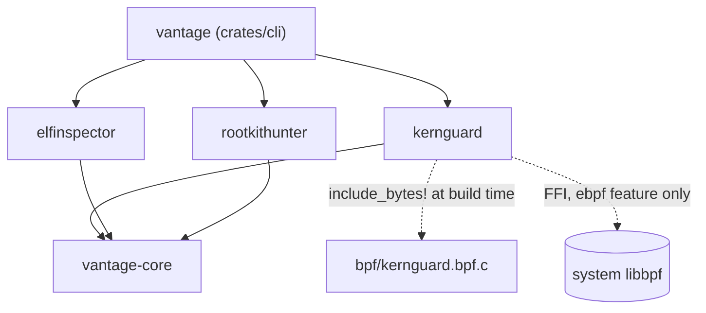
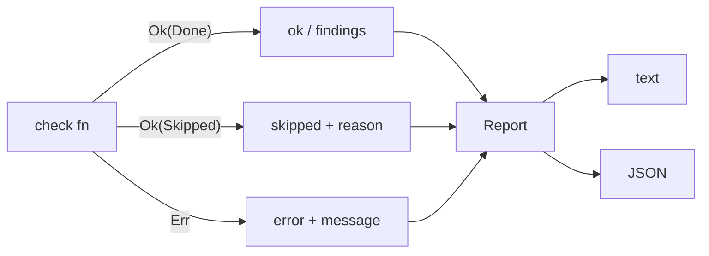
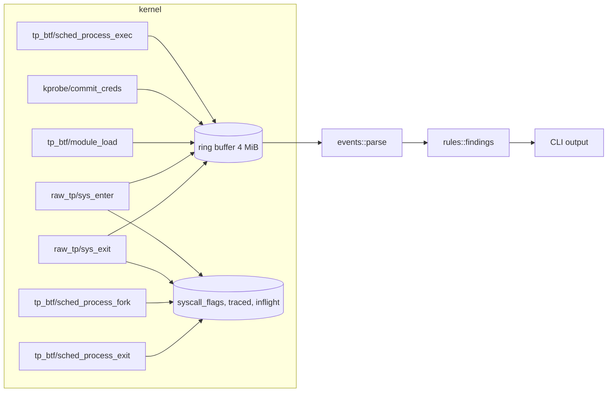
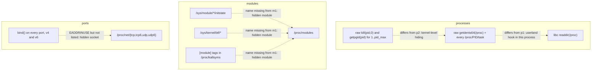
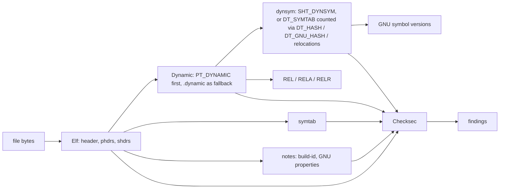

# Architecture

Vantage is a Cargo workspace with one shared library, three engines and a CLI. The engines do not depend on each other. Only the CLI combines them.

| crate | role | unsafe code |
|---|---|---|
| `vantage-core` | report model, JSON encoder/parser, raw syscalls, procfs and sysctl helpers, syscall number tables | raw syscall wrappers, `uname` |
| `elfinspector` | ELF parser and mitigation analysis | none (`#![forbid(unsafe_code)]`) |
| `rootkithunter` | rootkit and hiding detection | socket/bind probes |
| `kernguard` | eBPF monitoring and tracing, kernel hardening audit | libbpf FFI, fork/exec for `trace`, xattr reads |
| `vantage` | argument parsing, output, exit codes | none of its own beyond `localtime_r` |

The only crates.io dependency is `libc`. The eBPF loader links the system libbpf (1.0 or newer) through hand-written bindings for the few functions it uses.

## Report model

Every snapshot check returns an `Outcome`: either `Done { summary, findings }` or `Skipped(reason)`. `CheckResult::run` adds timing and turns errors into an `error` status. A check that cannot run because of missing privileges or kernel features says so in its reason. It never reports `ok` for something it did not look at.

Strings read from the system (file names, process names, symbol names, kernel strings) pass through `text::from_bytes`. That function escapes control characters and invalid UTF-8 as `\xNN` before anything is stored, so hostile names cannot inject terminal escape sequences or produce invalid JSON.

## KernGuard

The BPF object is compiled by `build.rs` with `clang -target bpf` and embedded in the binary. It does not include `vmlinux.h`. Kernel structures are declared with only the fields that are read, marked `preserve_access_index`, and libbpf relocates the field offsets against `/sys/kernel/btf/vmlinux` at load time (CO-RE). The same object therefore runs on any kernel from 5.15 on with BTF, on x86_64 and arm64.

Program sets per mode:

- `monitor` loads `on_exec`, `on_commit_creds`, `on_module_load` and `on_sys_enter`. `syscall_flags` marks only the watched syscalls, so all other syscalls return after one array lookup.
- `trace` loads `on_sys_enter`, `on_sys_exit`, `on_fork` and `on_exit`. The `traced` map starts with the target PID. `on_fork` adds children, and `on_exit` removes processes and stale in-flight entries.

Event layouts are fixed C structs. The C side checks sizes and offsets with `_Static_assert`. The Rust side decodes the bytes at explicit offsets and never transmutes. A per-CPU `drops` counter records ring buffer reservation failures, and the count is printed when the session ends.

Privilege escalation classification happens in userspace (`rules::creds`). The kprobe emits an event only when `commit_creds` raises the uid, euid or fsuid to 0 or adds effective capabilities. The event carries the syscall number of the calling task, read with `bpf_task_pt_regs`. The rules use that syscall to tell a setuid `execve` or a permitted `setresuid` apart from a credential change inside an unrelated syscall such as `ioctl`, which is what kernel exploit payloads produce.

`trace -- CMD` forks a child that blocks on a pipe until its PID is in the `traced` map. Only then does it call `execvp`, so the first syscall of the new program is already traced.

## RootkitHunter

Most checks compare two or more independent views of the same kernel state. A rootkit has to fake every view the same way to stay hidden.

Raw syscalls (`vantage_core::rawsys`) use inline assembly on x86_64 (`syscall`) and aarch64 (`svc 0`), so a library preloaded into vantage cannot intercept them. On other architectures they fall back to `libc::syscall`, which a preloaded library could hook. Every difference is re-read before it is reported, which keeps short-lived processes, files and sockets out of the findings.

`syscall-table` reads `sys_call_table` from `/proc/kcore`. A small reader takes the program headers to map kernel virtual addresses to file offsets. Each entry is resolved against `/proc/kallsyms` and must point at an arch syscall handler (`__x64_sys_*`, `__arm64_sys_*`, `sys_ni_syscall`) inside `_stext.._etext`.

## ELFInspector

The parser borrows the input slice. Every read goes through a bounds-checked `Reader` that handles both classes and both byte orders. Malformed tables become warnings rather than errors where the loader would still run the file. Dynamic information comes from `PT_DYNAMIC`, the same source the loader uses. When section headers are stripped, dynamic symbols and relocations are recovered from the dynamic segment. A test checks that both paths give identical results.
